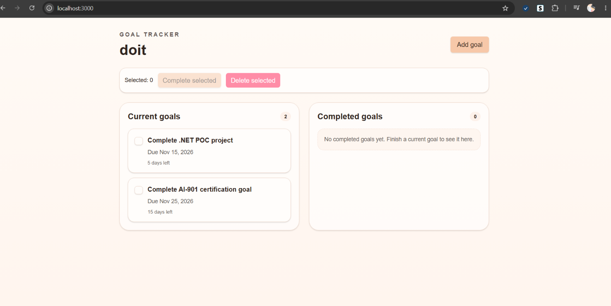
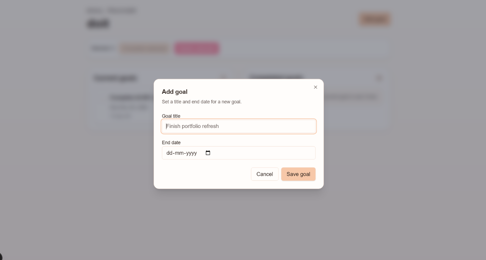
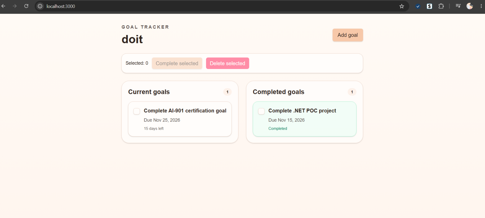
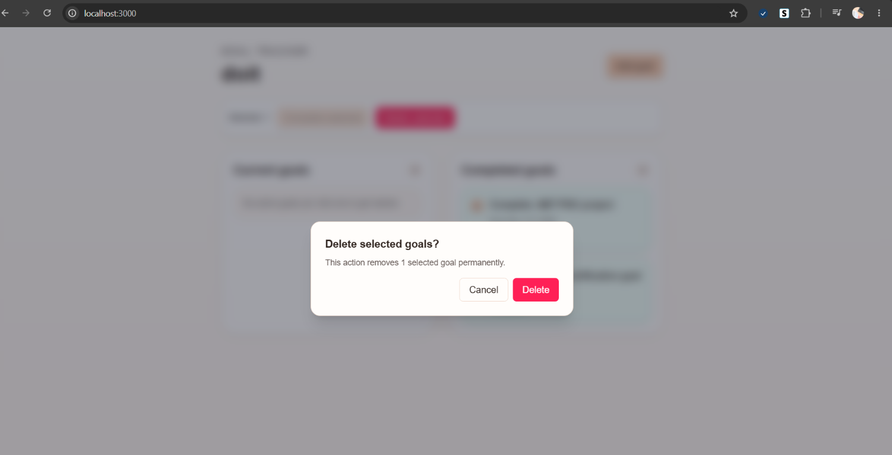

# GoalTracker

A simple goal-tracking web application for creating goals, keeping an eye on due
dates, and tracking what you've completed. The app was built with a Spec Kit
workflow.

## Screenshots

### Goal dashboard



### Add a goal



### Completed goal



### Delete a goal



## Features

- Create goals with a title and end date.
- See current and completed goals in separate lists.
- Track due dates, including overdue and upcoming goals.
- Select and complete or delete goals.
- Reorder goals within each list using drag and drop or Move up/Move down controls.
- Save goals in browser local storage, so they persist in the same browser.

> Goals are stored locally in your browser and are not synced between devices or
> browsers.

## Run locally

### Requirements

- Node.js (compatible with the Next.js version in `goal-tracker/package.json`)
- npm

### Install and start

From the repository root, run:

```bash
cd goal-tracker
npm install
npm run dev
```

Open [http://localhost:3000](http://localhost:3000) in your browser.

## Available commands

Run these commands from the `goal-tracker` directory:

| Command | Description |
| --- | --- |
| `npm run dev` | Start the local development server. |
| `npm run build` | Create a production build. |
| `npm run start` | Serve the production build. |
| `npm run lint` | Run ESLint. |

## Technology

- [Next.js](https://nextjs.org/) and [React](https://react.dev/)
- TypeScript
- [Tailwind CSS](https://tailwindcss.com/)
- [dnd-kit](https://dnd-kit.com/) for drag-and-drop sorting
- Browser local storage for goal persistence
